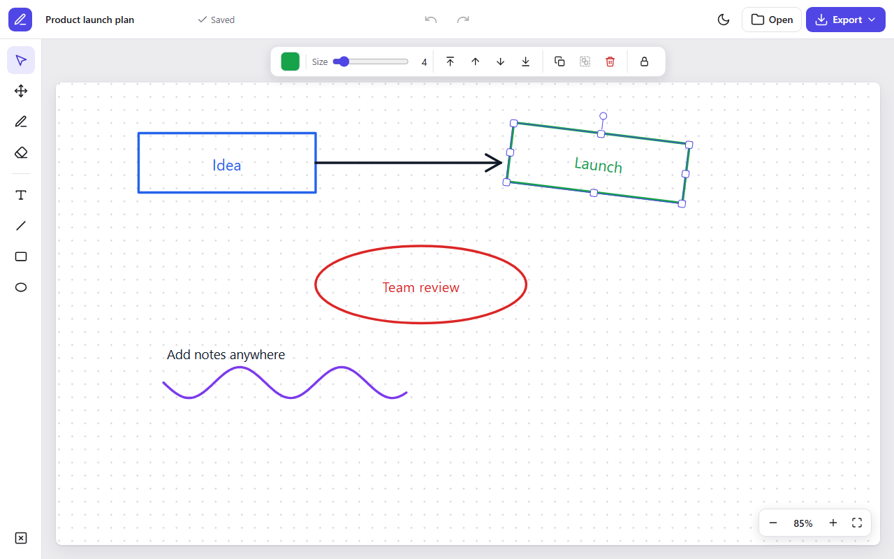

# Interactive White Board


**Live demo: https://kishore-1011.github.io/Interactive-white-board/**

A whiteboard that runs entirely in the browser. Sketch with a pen or shapes, place text anywhere, and pick up where you left off. There's no account and no server, and your board never leaves your device unless you export it.



## Features

- **Editor layout:** a tool rail on the left and a floating bar that shows only the options for what you've selected
- **Light and dark themes:** follows your system setting until you choose one, and the page stays white so it always matches your export
- **Named boards:** give the board a name and exported files use it
- **Drawing tools:** pen, line, rectangle and ellipse, with a colour picker and brush size
- **Eraser:** removes any stroke or shape it touches
- **Text:** double-click to edit, drag a corner to scale it, or drag a side to set where it wraps
- **Direct editing:** click anything to move, resize or rotate it with handles
- **Multiple selection:** drag across the board or Shift-click to work on several objects at once
- **Groups and locks:** group objects so they move together, and lock anything you don't want disturbed
- **Layers:** move any object forward, backward, to the front or to the back
- **Duplicate, copy and paste:** works on single objects and whole groups
- **Undo and redo:** up to 100 steps, covering every change to the board
- **Autosave:** the board is restored when you come back, using your browser's local storage
- **Large canvas:** pan in any direction, zoom from 10% to 400%, and fit everything on screen in one click
- **Export and open:** save the whole board as a PNG image, or as a JSON file you can open again later
- **Mouse and touch:** works with a mouse, a stylus or a finger, with pinch to zoom on phones and tablets

## Keyboard shortcuts

| Keys | Action |
|---|---|
| <kbd>Ctrl</kbd> + <kbd>Z</kbd> | Undo |
| <kbd>Ctrl</kbd> + <kbd>Y</kbd> or <kbd>Ctrl</kbd> + <kbd>Shift</kbd> + <kbd>Z</kbd> | Redo |
| <kbd>Ctrl</kbd> + <kbd>C</kbd> / <kbd>X</kbd> / <kbd>V</kbd> | Copy, cut, paste |
| <kbd>Ctrl</kbd> + <kbd>D</kbd> | Duplicate |
| <kbd>Ctrl</kbd> + <kbd>A</kbd> | Select everything that isn't locked |
| <kbd>Ctrl</kbd> + <kbd>G</kbd> | Group |
| <kbd>Ctrl</kbd> + <kbd>Shift</kbd> + <kbd>G</kbd> | Ungroup |
| <kbd>Ctrl</kbd> + <kbd>]</kbd> / <kbd>[</kbd> | Bring to front, send to back |
| <kbd>Ctrl</kbd> + scroll | Zoom at the pointer |
| <kbd>Ctrl</kbd> + <kbd>=</kbd> / <kbd>-</kbd> | Zoom in, zoom out |
| <kbd>Ctrl</kbd> + <kbd>0</kbd> | Reset to 100% |
| <kbd>Shift</kbd> + <kbd>1</kbd> | Fit everything on screen |
| Scroll, or hold <kbd>Space</kbd> and drag | Pan |
| <kbd>Shift</kbd> while resizing | Keep proportions |
| <kbd>Shift</kbd> while rotating | Snap to 15° steps |
| <kbd>Delete</kbd> or <kbd>Backspace</kbd> | Delete the selection |
| <kbd>Esc</kbd> | Finish editing, or deselect |

## Run it

Open `index.html` in a browser, or serve the folder:

```bash
python -m http.server 8000
```

Then visit http://localhost:8000. There's no build step and nothing to install, and it works offline.

## How it works

The board is stored as plain data: one list of objects, ordered from back to front. Each object is drawn as its own element, using SVG for shapes and HTML for text, so the browser handles clicking on the exact stroke. Each change saves a snapshot of the list, which is what powers undo, redo, autosave and JSON export.

## Project structure

```
Interactive-white-board/
├── index.html    # Editor layout, icons and selection handles
├── style.css     # Themes, editor layout and responsive rules
├── script.js     # Board data, editing, undo and saving
└── docs/         # Screenshot for this README
```

## License

[MIT](LICENSE)
